

<picture>
  <source media="(prefers-color-scheme: dark)" srcset="assets/branding/approved/PNG/Dark/fenb-dark-horizontal-transparent.png">
  <source media="(prefers-color-scheme: light)" srcset="assets/branding/approved/PNG/Light/fenb-light-horizontal-transparent.png">
  
</picture>

# FENB

**A fresh look for the world of Flyff.**

A graphics mod inspired by ENBSeries, with adjustable effects and an in-game settings panel.

**[Releases](https://github.com/d3ede/fenb/releases)** · [Effects](#effects-in-action) · [Comparisons](#in-game-comparisons) · [Installation](#installation) · [Hotkeys](#hotkeys) · [Report an issue](https://github.com/d3ede/fenb/issues)

---

## What FENB offers

| | Features |
| --- | --- |
| **Color & bloom** | Adjust exposure, contrast, saturation, temperature and soft light bloom. |
| **Materials** | A dedicated tab for subtle relief and restrained light-dependent highlights on recognized snow, stone, wood, sand and ground, preserving the game's painted style. Snow has a separate appearance control. Uses the original artwork without added grain, texture-file replacement or geometry. Off by default. Optional image microcontrast is available separately in this tab. |
| **Light & atmosphere** | SSAO, sun rays, a smooth sun core and halo, reconstructed sky/cloud textures and fine night stars, distance and height fog, depth of field, brightness adaptation and local lighting. |
| **Time & weather** | Live time-of-day controls, freeze time and clear/rain/snow with adjustable intensity on the supported Homesickness client. Time works with image effects disabled. Switch either override off to follow the game. |
| **WaterFX** | Animated wave shading, refraction, depth-based absorption, optional caustics and refractive footsteps. Separate Sky Only / SSR Performance / SSR Quality modes, reflection resolution and tracing controls. |
| **Surface reflections** | Optional polished paving and stone, with screen-space object reflections, captured sky fallback, directional highlights and material-dependent roughness. Strength, roughness and distance controls; grass stays nonreflective. Off-screen objects are unavailable to SSR. |
| **Particle processing** | Optional color, intensity, soft edges and local glow for recognized world particles, with detailed texture reconstruction, native blending and enhanced recognized world-light curtains. A dedicated aura control enriches recognized equipment refinement, pet-bead and elemental weapon glows. Particle processing and detailed effect quality are off by default. |
| **Antialiasing** | FXAA, SMAA and hardware MSAA where supported. |
| **FPS unlock** | Optional per-frame movement, animation, input and camera updates on supported Homesickness builds, while combat counters, particle motion and effect lifetimes retain their native timing. Cloud-layer drift follows elapsed time. The fallback retains native actor positions, with camera smoothing and draw-scoped animation sampling. Driver and VSync limits still apply. |
| **Background activity** | Optional **Run in background** switch in the panel footer, beside **Unlock FPS**. Keeps native world updates and existing attacks running while minimized or inactive, independently of FPS unlock. Keeps the normal render loop and camera follow active; desktop key presses are ignored during background updates. Off by default; switching it off restores native background resource saving. |
| **Optimization** | A bounded resource-lookup cache reduces proxy overhead without changing rendering. Optional shop-sign range, native decorative-effect hiding and player skill-effect hiding are off by default. The skill-effect option also hides your own effects; characters and trading remain active. |
| **Profiles** | Nine translated built-in looks: Default, High-end PC, Low-end PC, Potato, Blue Water, Cyan Water, Warm tones, Cool tones and Soft colors. High-end PC adds detailed effects, particle processing, paving reflections, full-resolution 48-step water SSR and subtle caustics. Low-end PC disables SSAO; Potato uses FXAA and disables costly water and scene effects. The water variants keep the default image settings; the three gentle color looks keep Default's effects and water. Save your own profiles alongside them. Settings save automatically. |
| **In-game controls** | Grouped navigation and a dedicated settings pane in English, Russian, Spanish and Brazilian Portuguese. Inactive effect names stay readable, with status indicators, individual switches, numeric inputs and parameter resets. Small windows use a section dropdown. Tahoma typography, muted violet accents and the optional compact cursor are retained. FPS unlock and background activity stay together in the footer and remain independent between running clients. Processing preserves the game HUD. |
| **Panel updates** | New-version notice when opening the panel, verified downloads and a restart prompt. Settings and profiles stay in place; the previous DLL is kept for rollback. No separate updater executable. |

## Effects in action

In-game captures cropped to focus on each effect, without the HUD or minimap. Colors are unchanged from the captures. Click an image for the full-size crop.

<strong>Color & weather — desaturated snowfall</strong>

Reduced saturation and the snow weather override give the town a monochrome winter look.

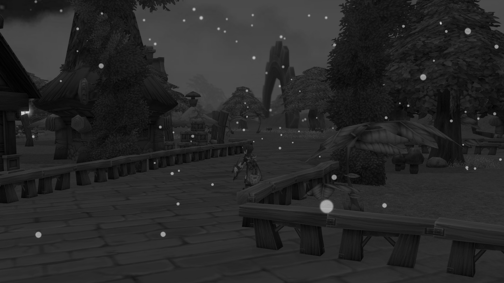

<strong>Local lighting — off / on</strong>

The same lamppost with local lighting disabled and enabled. Look at the warm light on the benches and paving around its base.

| Off | On |
| :---: | :---: |
| 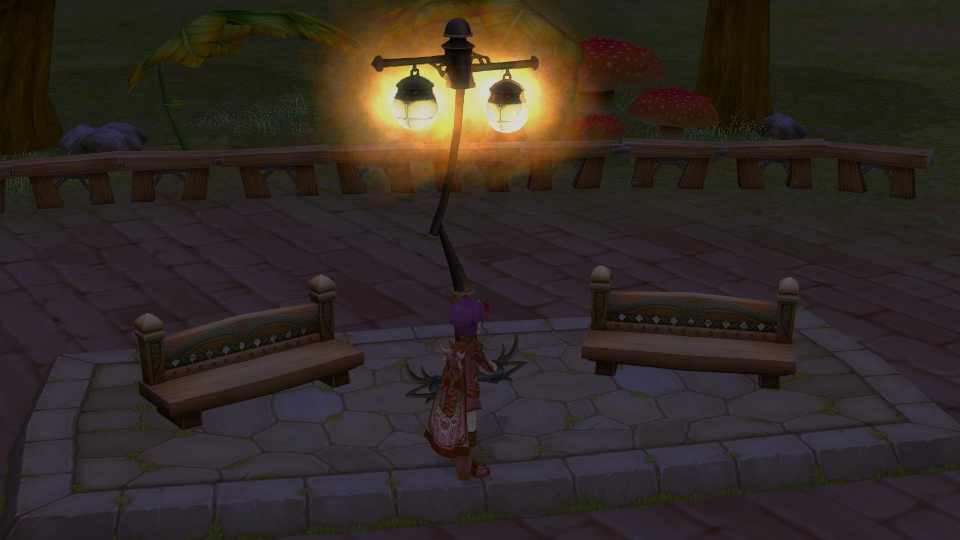 | 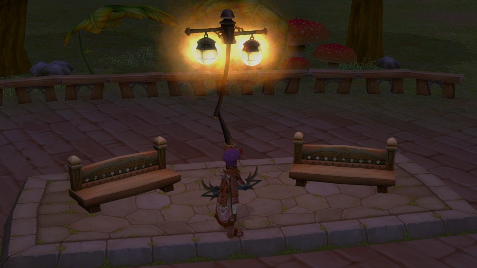 |

<strong>Water reflections — three modes</strong>

The same stretch of river with **Sky Only**, **SSR Performance** and **SSR Quality**. Compare the bridge and tree reflections; screen-space reflections depend on visible scene content.

| Sky Only | SSR Performance | SSR Quality |
| :---: | :---: | :---: |
| 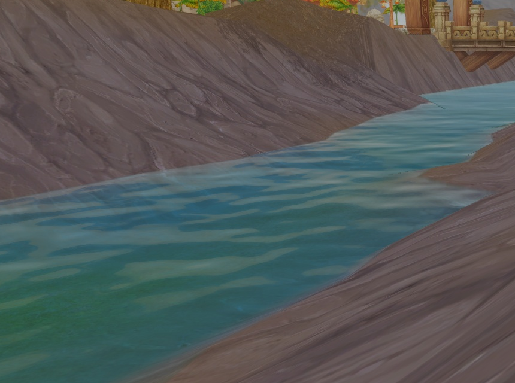 | 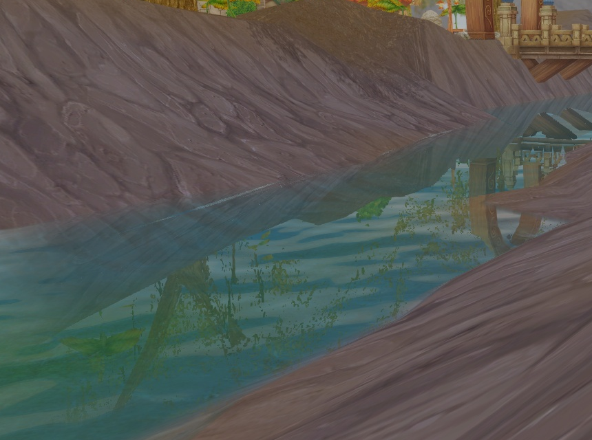 | 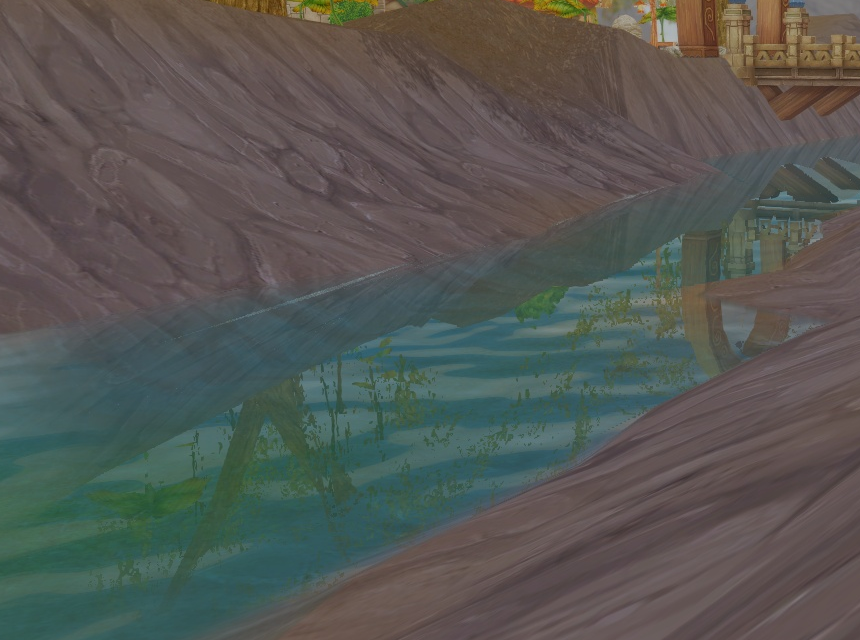 |

<strong>Water appearance — different settings</strong>

Three water configurations in the same scene, showing different surface color and reflection balance.

| Variation 1 | Variation 2 | Variation 3 |
| :---: | :---: | :---: |
| 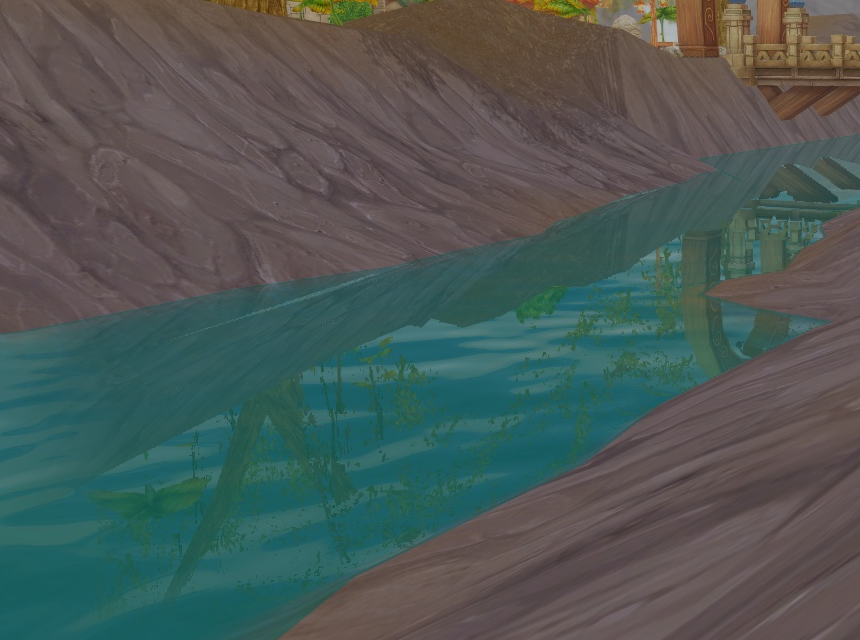 | 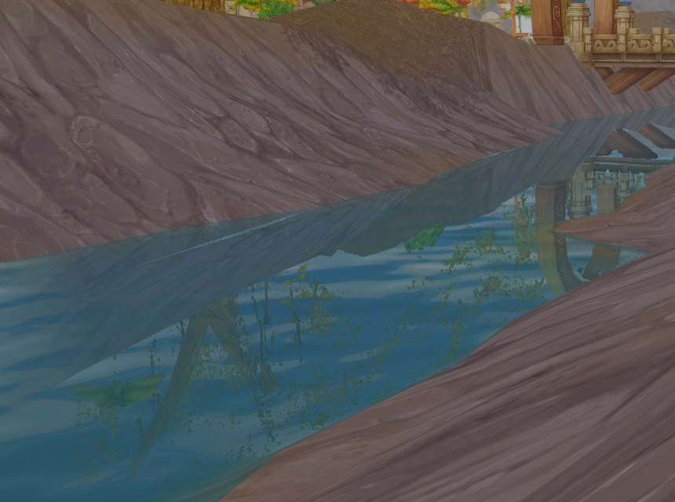 | 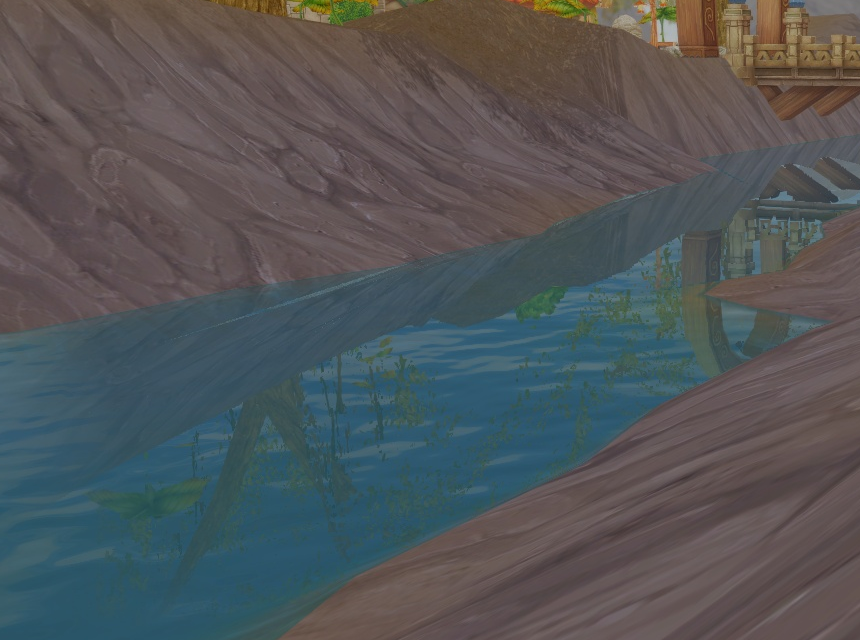 |

## In-game comparisons

**Original above, FENB below.** Each pair uses the same crop, with the game interface removed. Captures were taken moments apart, so animated objects may differ.

<strong>01 — River</strong>

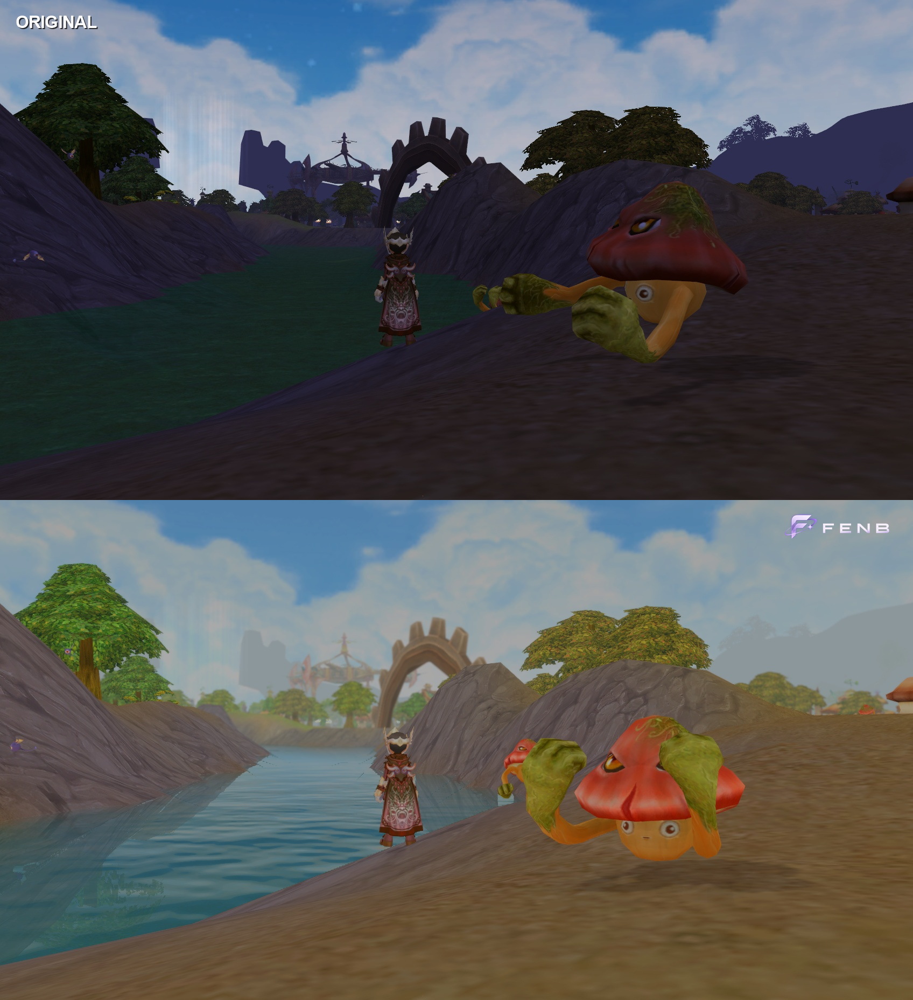

<strong>02 — Lake</strong>

<strong>03 — Town</strong>

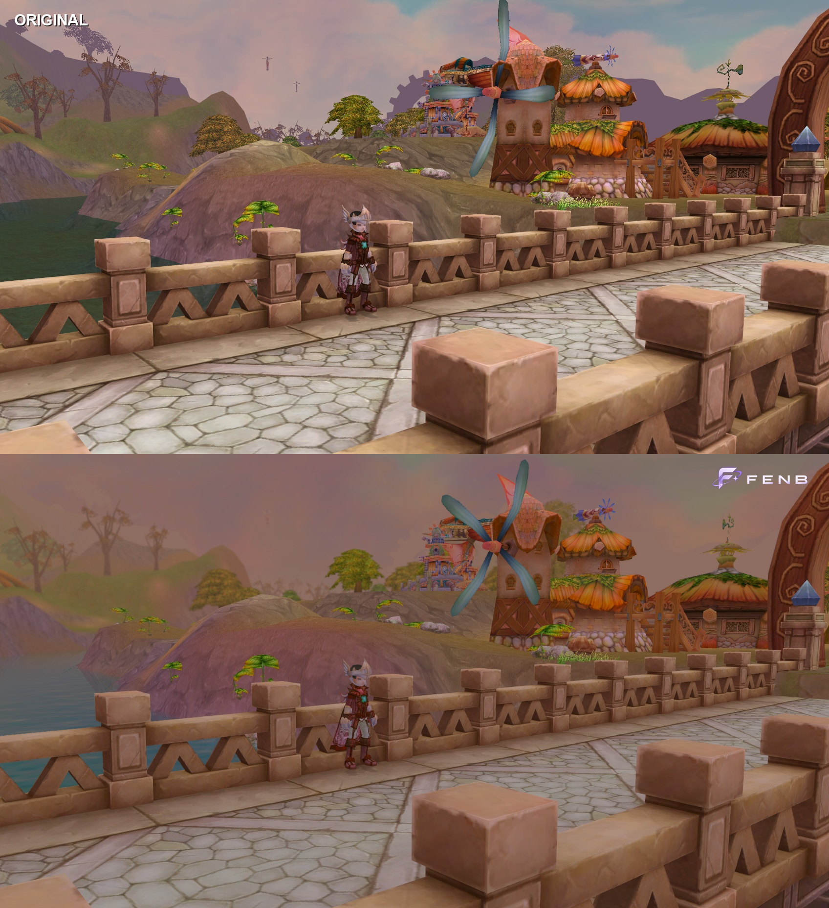

## Installation

**Requirements:** Windows and a compatible **32-bit DirectX 9 Flyff client** (`Neuz.exe`). No installer is needed.

1. Close the game. Download and extract **`FENB-<version>-win32.zip`** from the [latest release](https://github.com/d3ede/fenb/releases/latest), or use the `dist/` output of a local build.
2. Copy **`d3d9.dll`** and **`FENB.ini`** into the game folder, beside **`Neuz.exe`**, and keep **`LICENSES.txt`** with them. The archive's **`INSTALL.txt`** contains English instructions followed by Russian instructions. Built-in profiles are embedded in the DLL; `FENB-presets/` is created for your own profiles when needed.
3. Launch the game normally and press **Shift + Enter** to open the panel.
4. Choose a profile or adjust the effects to your liking. Changes save automatically.

The combined `LICENSES.txt` preserves FENB and third-party license notices. If the game folder already contains another `d3d9.dll`, back it up first; loading multiple graphics proxies together is not currently supported.

**Updating:** open the panel to check for a new version, or choose **FENB updates** in the **…** menu. Download the update, close the game when prompted, wait for the completion message, then launch normally. The panel uses Windows PowerShell in the background and needs Internet access and write access to the game folder. Your `FENB.ini` and `FENB-presets/` are preserved. **Restore previous version** schedules a rollback after exit; installation errors trigger automatic restoration. Manual updates remain available by replacing the DLL with the game closed. See [update and recovery details](docs/RENDERING.md#panel-updates-and-recovery).

**Upgrading from 0.4a or earlier:** replace the DLL manually once to install the panel updater introduced in 0.5a. Keep your existing configuration and custom profiles.

**Uninstalling:** close the game and remove FENB's `d3d9.dll`. Restore the original DLL if you backed one up. Your configuration and profiles can be kept for later.

## Hotkeys

| Shortcut | Action |
| --- | --- |
| **Shift + Enter** | Open or close the FENB panel. Either Shift key works. |
| **Right Shift + F12** | Toggle FENB image effects with the panel open or closed. |
| **Ctrl + S** | Save settings immediately while the panel is open. |
| **Esc** | Close the panel when not editing a text field. |

Settings also save automatically. The local time override remains active when image effects are disabled.

## Compatibility

FENB is in active development and currently targets the **Homesickness Flyff client**. Other Flyff clients are not yet verified. Native FPS and environment controls use structural function checks rather than a whole-file hash, allowing compatible client updates; changed or ambiguous renderer layouts remain unsupported.

Depth-based effects currently need a supported **NVIDIA driver depth-copy path**. Unsupported effects fall back or remain inactive; reflections also depend on what is visible on screen. See the [rendering notes](docs/RENDERING.md) for effect details, limitations and local build instructions.

Found a problem? [Open an issue](https://github.com/d3ede/fenb/issues) with your FENB version, client, GPU and steps to reproduce it.
