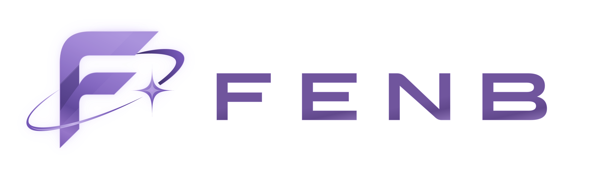
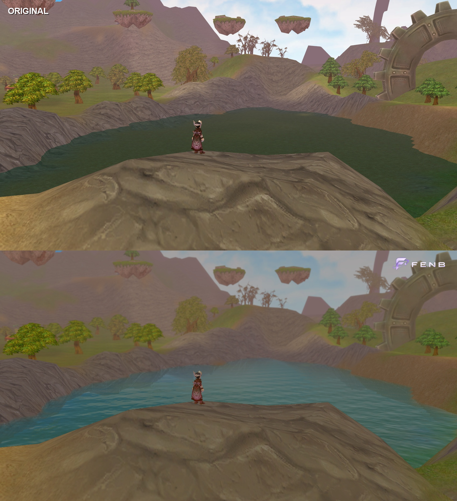

<picture>
  <source media="(prefers-color-scheme: dark)" srcset="assets/branding/approved/PNG/Dark/fenb-dark-horizontal-transparent.png">
  <source media="(prefers-color-scheme: light)" srcset="assets/branding/approved/PNG/Light/fenb-light-horizontal-transparent.png">
  
</picture>

# FENB

**A fresh look for the world of Flyff.**

A graphics mod inspired by ENBSeries, with adjustable effects and an in-game settings panel.

**[Releases](https://github.com/d3ede/fenb/releases)** · [Comparisons](#in-game-comparisons) · [Installation](#installation) · [Hotkeys](#hotkeys) · [Report an issue](https://github.com/d3ede/fenb/issues)

---

## What FENB offers

| | Features |
| --- | --- |
| **Color & bloom** | Adjust exposure, contrast, saturation, temperature and soft light bloom. |
| **Light & atmosphere** | SSAO, sun rays, reconstructed sky/cloud textures and fine night stars, distance and height fog, depth of field, brightness adaptation and local lighting. |
| **Time & weather** | Live time-of-day controls, freeze time and clear/rain/snow with adjustable intensity on the supported Homesickness client. Time works with image effects disabled. Switch either override off to follow the game. |
| **WaterFX** | Animated wave shading, refraction, reflections, depth-based absorption, optional caustics and independent refractive footsteps. |
| **Particle processing** | Adjustable color, intensity, soft edges and local glow for recognized world particles, with detailed texture reconstruction, native blending and enhanced recognized world-light curtains. |
| **Antialiasing** | FXAA, SMAA and hardware MSAA where supported. |
| **Profiles** | Five translated built-in looks: Default, Clear water, Golden light, Soft atmosphere and Night lights. Save your own profiles alongside them. Settings save automatically. |
| **In-game controls** | Compact English/Russian panel with muted violet accents, animated switches and dropdown arrows, an optional compact cursor, individual effect switches and a master toggle. Unlock FPS stays visible in the footer on supported clients. Processing preserves the game HUD. |

## In-game comparisons

**Original above, FENB below.** Each pair uses the same crop, with the game interface removed. Captures were taken moments apart, so animated objects may differ.

<strong>01 — River</strong>

<strong>02 — Lake</strong>

<strong>03 — Town</strong>

## Installation

**Requirements:** Windows and a compatible **32-bit DirectX 9 Flyff client** (`Neuz.exe`). No installer is needed.

1. Close the game. Download and extract **`FENB-<version>-win32.zip`** from the [latest release](https://github.com/d3ede/fenb/releases/latest), or use the `dist/` output of a local build.
2. Copy **`d3d9.dll`** and **`FENB.ini`** into the game folder, beside **`Neuz.exe`**, and keep **`LICENSES.txt`** with them. The archive's **`INSTALL.txt`** contains English instructions followed by Russian instructions. Built-in profiles are embedded in the DLL; `FENB-presets/` is created for your own profiles when needed.
3. Launch the game normally and press **Shift + Enter** to open the panel.
4. Choose a profile or adjust the effects to your liking. Changes save automatically.

The combined `LICENSES.txt` preserves FENB and third-party license notices. If the game folder already contains another `d3d9.dll`, back it up first; loading multiple graphics proxies together is not currently supported.

**Updating:** close the game before replacing the DLL. Keep your existing `FENB.ini` and `FENB-presets/` to retain your settings and profiles.

**Uninstalling:** close the game and remove FENB's `d3d9.dll`. Restore the original DLL if you backed one up. Your configuration and profiles can be kept for later.

## Hotkeys

| Shortcut | Action |
| --- | --- |
| **Shift + Enter** | Open or close the FENB panel. Either Shift key works. |
| **Right Shift + F12** | Toggle FENB image effects with the panel open or closed. |
| **Ctrl + S** | Save settings immediately while the panel is open. |
| **Esc** | Close the panel when not editing a text field. |

Settings also save automatically. The local time override remains active when image effects are disabled.

## Compatibility

FENB is in active development and currently targets the **Homesickness Flyff client**. Other Flyff clients are not yet verified. Native FPS and environment controls use structural function checks rather than a whole-file hash, allowing compatible client updates; changed or ambiguous renderer layouts remain unsupported.

Depth-based effects currently need a supported **NVIDIA driver depth-copy path**. Unsupported effects fall back or remain inactive; reflections also depend on what is visible on screen. See the [rendering notes](docs/RENDERING.md) for effect details, limitations and local build instructions.

Found a problem? [Open an issue](https://github.com/d3ede/fenb/issues) with your FENB version, client, GPU and steps to reproduce it.
